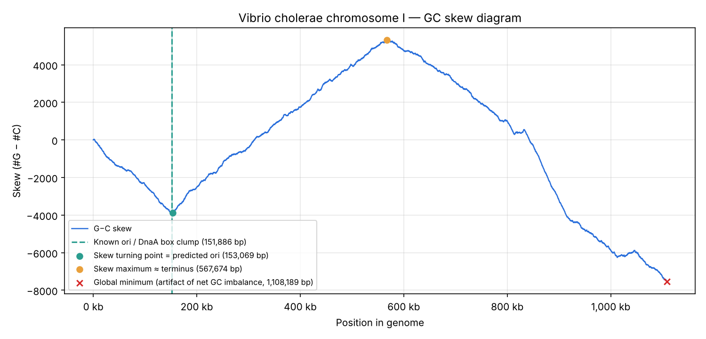

# ori-finder: Locating the Origin of Replication in Bacterial Genomes

A Python toolkit for predicting where DNA replication begins (the **ori**) in a bacterial genome, applied to the full 1.1 Mb chromosome I of *Vibrio cholerae*. It combines two independent signals: **GC skew**, a mutational footprint left by replication itself, and **clumps of DnaA boxes**, the short motifs that the initiator protein DnaA binds. It then checks where the two agree.



## Results on *V. cholerae*

| Signal | Method | Prediction |
|---|---|---|
| GC skew turning point | `SkewArray` (circular interpretation) | **153,069 bp** |
| DnaA box clump | `FindClumps(k=9, L=500, t=3)` + reverse-complement filter | **151,913 bp** |
| Known ori | 540 bp experimentally characterized region | **151,886 – 152,425 bp** |

- Out of 124 clumping 9-mers in the genome, only one non-trivial k-mer also has a clumping reverse complement: **`ATGATCAAG` / `CTTGATCAT`**. That is the *V. cholerae* DnaA box. Its densest cluster is 5 hits within one 500 bp window, inside the known ori.
- The skew peaks at **567,674 bp**, which marks the replication terminus, roughly opposite the ori.
- **A pitfall:** the naive `MinimumSkew` returns 1,108,189 bp (the very end of the sequence). That point is an artifact: the chromosome has a net excess of C over G, so the skew never returns to 0. Because the genome is circular, the curve keeps descending across the wrap from 567 kb → end → 0 → 152 kb as one continuous reverse half-strand. Reading the skew diagram as a circle gives the correct turning point, about 1.2 kb from the true ori.

## Biological background

Replication proceeds in both directions from the ori. One half of each strand (the *forward half-strand*) is copied discontinuously as the lagging strand, so it spends more time single-stranded. Single-stranded DNA is prone to **cytosine deamination** (C → T, then the partner G → A on the next round). Over evolutionary time, forward half-strands lose C relative to G.

- The **skew** (#G − #C, accumulated along the genome) decreases on reverse half-strands and increases on forward half-strands. Its turning point marks the ori.
- **DnaA boxes** are ~9 bp motifs that occur several times within the ori on both strands, often with small mismatches. They appear as **clumps** of a k-mer *and* its reverse complement.

## Features

| Function | Purpose |
|---|---|
| `PatternCount`, `PatternMatching` | Count or locate exact occurrences of a pattern |
| `FrequencyMap`, `FrequentWords` | Most frequent k-mers |
| `ReverseComplement` | Opposite-strand sequence |
| `SymbolArray` | Nucleotide counts in sliding half-genome windows (circular) |
| `SkewArray`, `MinimumSkew` | GC skew and its minima |
| `HammingDistance`, `ApproximatePatternMatching`, `ApproximatePatternCount` | Matching with up to *d* mismatches |
| `FindClumps` | (L, t)-clumps of k-mers in O(n) time using a sliding frequency window (≈0.5 s on 1.1 Mb) |

`replication_origin.py` also includes an **interactive command-line menu**. It can load the built-in ori, download the ori or full genome from the course datasets, read a pasted sequence or a FASTA/text file, plot the skew diagram, and run the full DnaA box search.

## Usage

```bash
git clone https://github.com/PIAstachio/ori-finder.git
cd ori-finder
pip install -r requirements.txt   # matplotlib, only needed for plots
python3 replication_origin.py
```

Pick option **3** on the start screen to download the full *V. cholerae* genome. A copy is saved locally after the first download. Then try:

- **8**: plot the skew diagram
- **13**: find clumps and candidate DnaA boxes (k=9, L=500, t=3)

The functions can also be imported directly:

```python
from replication_origin import FindClumps, SkewArray, ReverseComplement
```

## Tests

```bash
python3 -m unittest
```

14 tests check each function against the course's sample datasets, plus edge cases such as unequal-length Hamming inputs, lowercase DNA, and k longer than the text.

## Data

- Genome: [Vibrio_cholerae.txt](https://bioinformaticsalgorithms.com/data/realdatasets/Replication/Vibrio_cholerae.txt)
- ori: [v_cholerae_oric.txt](https://bioinformaticsalgorithms.com/data/realdatasets/Replication/v_cholerae_oric.txt)

Both are from the datasets accompanying *Bioinformatics Algorithms* by Phillip Compeau and Pavel Pevzner.

## Acknowledgments

Built while completing *Biology Meets Programming: Bioinformatics for Beginners* (UC San Diego, Coursera). The core functions follow the course exercises. The interactive interface, linear-time clump finder, circular skew analysis, plotting, and tests are extensions.

## Author

**Priyal (Pia) Saraf**, Neuroscience B.S., UC Riverside · [GitHub](https://github.com/PIAstachio)
